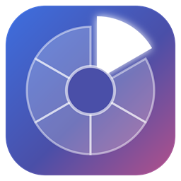
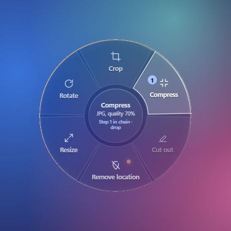
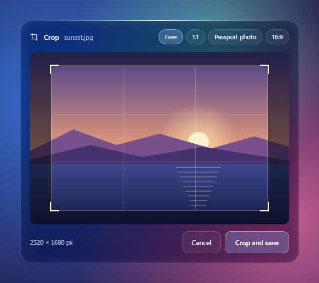

# Swivra

[Türkçe](README.tr.md)

An offline file wheel for Windows. While you drag a file, press **Shift**, **Ctrl** or **Alt** and a wheel opens around the cursor. Drop the file on a slice and you are done. Your files are never uploaded anywhere; everything happens on your own PC.



## What it does

There are three wheels. The key you press decides which one opens.

### Convert (Shift)

- **Images:** to PNG, JPG, BMP, WebP or PDF.
- **PDF:** every page to a PNG or JPG (200 dpi), extract the text, or convert to Word.
- **Documents** (Word, text, Markdown): to PDF, text or Word.

### Tools (Ctrl)

- **Images:** crop, compress, remove the background, rotate, resize to 1080 pixels wide, remove location and camera data.
- **PDF:** compress, hide sensitive data, split into pages, merge, rotate, lock with a password.
- **Other files:** compress into a zip, put into a password-protected zip. Hide sensitive data in text and Word files.

### Send (Alt)

- **WhatsApp:** The file is copied to the clipboard and WhatsApp opens. Open a chat and press Ctrl+V. Images are downscaled first and their location data is removed.
- **Mail:** A new message opens in your default mail app with the file attached. If you have no mail app, the file is copied to the clipboard and a new Gmail message opens in your browser; paste or drag the file into it.
- **To phone:** A QR code appears. Scan it with a phone on the same Wi-Fi and the file downloads straight from your PC. The link is random every time and stops working when you close the panel or after 10 minutes.
- **Copy path:** Copies the file's full path to the clipboard.

## Highlights

- **Chains:** Rest on a slice for about half a second and that step joins a chain. When you drop the file, every step in the chain runs in order. For example: rotate, then remove location data, then convert to JPG.
- **Sensitive-data radar:** While you drag, Swivra looks inside the file. If it finds location data, a camera model, a Turkish ID number, an IBAN, an e-mail address or a phone number, the edge of the wheel turns orange. For PDFs, the first 20 pages are scanned.
- **Real redaction:** In PDFs, hidden items are covered with black boxes and the pages are turned into images, so the covered text cannot be copied back out. In text and Word files the items are replaced with block characters.
- **Your original is never changed:** The result is always saved next to the original under a new name, for example `Holiday-clean.jpg`.
- **Several files at once:** Drag several files together. Dropping several PDFs on **Merge** gives you one PDF.
- **Turkish and English:** Switch the language from the tray menu.



## Install

1. Download the latest `Swivra-<version>-win-x64.zip` from [Releases](../../releases).
2. Extract the zip into any folder.
3. Run `Swivra.exe`. It sits in the system tray next to the clock.

You need Windows 10 or 11 (64-bit) and the WebView2 Runtime, which comes preinstalled on Windows 11. You do not need to install .NET.

The app is not code-signed, so Windows SmartScreen may warn you the first time. Click "More info", then "Run anyway".

## Usage

1. Start dragging a file in File Explorer or on the desktop.
2. While dragging, press **Shift** (Convert), **Ctrl** (Tools) or **Alt** (Send). The wheel opens around the cursor.
3. Move over a slice. The center of the wheel tells you what will happen.
4. Drop the file on the slice.

- To cancel, drop the file in the center of the wheel.
- In the crop and password panels, **Enter** confirms and **Esc** cancels.
- To change the language, right-click the tray icon and use **Dil / Language**. On first start, Swivra follows your Windows display language.
- Swivra only works while it is running. On first start it asks whether to start with Windows; you can change this later with **Start with Windows** in the tray menu.
- The tray menu also has **Show the wheel (demo)**, **Open logs** and **Exit**.

## Good to know

- **Converting to Word, and documents to PDF:** To keep the page layout, Swivra uses an office program already on your PC: Microsoft Word first, then [LibreOffice](https://www.libreoffice.org/) (free). It finds them by itself and runs them in the background, with macros turned off. With neither installed, only the text is converted, and the result says so. Old `.doc`, `.rtf` and `.odt` files always need one of them.
- **To phone:** The first time, Windows Firewall asks whether Swivra may use the network. If you do not allow it, your phone cannot connect.
- **Password-protected zip:** Encrypted with AES-256. The zip support built into Windows cannot open it; use [7-Zip](https://www.7-zip.org/).
- **Scanned documents:** Text inside scanned page images cannot be read yet, so the radar and redaction do not see it.
- **Background removal:** Runs entirely on your PC with a small AI model (U-2-Net). It works well on clear subjects; hair and fine edges are not perfect.
- **Internet:** Swivra sends nothing to the internet. Only the To phone slice uses your local network, and only while its panel is open.
- **Logs:** Written to `%LOCALAPPDATA%\Swivra\swivra.log`. Passwords and share links are never logged.

## Build from source

You need Windows 10 or 11, the [.NET 10 SDK](https://dotnet.microsoft.com/download) and the WebView2 Runtime.

```powershell
cd src/Swivra.App
dotnet run
```

To build the release package (win-x64, no .NET needed on the target PC):

```powershell
pwsh scripts/publish.ps1
```

The package is written to `publish/Swivra-<version>-win-x64.zip`. The app ships as a folder, not a single exe: `web/`, `models/` and the required libraries sit next to `Swivra.exe`.

### Developer options

| Option | What it does |
| --- | --- |
| `--demo --shot out.png` | Opens the wheel with a sample file and saves a screenshot. |
| `--demo-tool crop\|lock\|tel <file>` | Opens the crop, password or phone panel for a real file without dragging. |
| `--run step,step <file> ...` | Runs steps without the UI, for example `--run png,rot file.pdf`. Optional: `--password pw` and `--crop x,y,width,height`. |
| `--radar <file>` | Scans a file and writes what it finds to the log. |
| `--lang tr\|en` | Picks the language for that run only. |

Results of `--run` and `--radar` are written to the log file.

## How it works

- **Keyboard and mouse listener** (`InputHook`): Notices when Shift, Ctrl or Alt is pressed during a drag. It never blocks a key.
- **Wheel window** (`OverlayForm`): A round, always-on-top window that never steals focus. WebView2 draws the wheel (`web/`). The glass effect is a blurred screenshot of the area behind the wheel, taken just before it opens.
- **Drop target** (`CatcherForm`): A nearly invisible window on top of the wheel. It is what actually receives the file, and it always reports the drop as a copy, so File Explorer never moves your original.
- **Processing:** Images use GDI+ and SkiaSharp; PDFs use PDFium, PdfPig and PDFsharp; Word files use the Open XML SDK, and Microsoft Word or LibreOffice when the layout must be kept; password-protected zips use SharpZipLib; background removal uses ONNX Runtime; QR codes use QRCoder.

## License

[MIT](LICENSE). The open-source components Swivra uses, and their licenses, are listed in [THIRD-PARTY-NOTICES.md](THIRD-PARTY-NOTICES.md).
