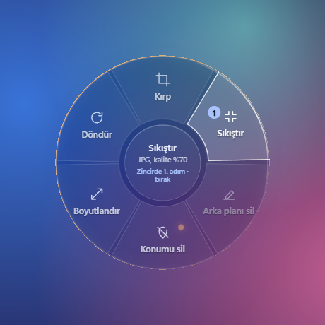
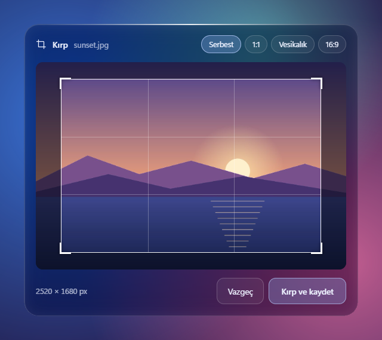

# Swivra

[English](README.md)

Windows için çevrimdışı çalışan bir dosya çarkı. Bir dosyayı sürüklerken **Shift**, **Ctrl** ya da **Alt** tuşuna basarsın, imlecin etrafında bir çark açılır. Dosyayı istediğin dilime bırakırsın, iş biter. Dosyaların hiçbir siteye yüklenmez, her şey kendi bilgisayarında olur.



## Neler yapabilir

Üç çark var. Hangisinin açılacağını bastığın tuş belirler.

### Dönüştür (Shift)

- **Resim:** PNG, JPG, BMP, WebP ya da PDF'e çevirme.
- **PDF:** her sayfayı ayrı bir PNG ya da JPG'ye çevirme (200 dpi), metni çıkarma, Word'e çevirme.
- **Belge** (Word, metin, Markdown): PDF, metin ya da Word'e çevirme.

### Araçlar (Ctrl)

- **Resim:** kırpma, sıkıştırma, arka planı silme, döndürme, 1080 piksel genişliğe küçültme, konum ve cihaz bilgisini silme.
- **PDF:** sıkıştırma, hassas bilgileri gizleme, sayfalara bölme, birleştirme, döndürme, parolayla kilitleme.
- **Diğer dosyalar:** zip'e sıkıştırma, parolalı zip'e koyma. Metin ve Word dosyalarında hassas bilgileri gizleme.

### Gönder (Alt)

- **WhatsApp:** Dosya panoya kopyalanır ve WhatsApp açılır. Bir sohbete girip Ctrl+V yapman yeterli. Resimler gönderilmeden önce küçültülür, konum bilgisi silinir.
- **Mail:** Varsayılan e-posta programında, dosya ekli yeni bir ileti açılır. Bilgisayarında e-posta programı yoksa dosya panoya kopyalanır ve tarayıcıda yeni bir Gmail iletisi açılır. Dosyayı iletiye yapıştırman ya da sürüklemen yeterli.
- **Telefona:** Ekranda bir QR kod çıkar. Aynı Wi-Fi ağındaki telefonunla okutunca dosya doğrudan bilgisayarından iner. Bağlantı adresi her seferinde rastgele oluşturulur. Panel kapanınca ya da 10 dakika sonra adres geçersiz olur.
- **Yolu kopyala:** Dosyanın tam yolunu panoya kopyalar.

## Öne çıkanlar

- **Zincir:** Bir dilimin üstünde yarım saniye kadar beklersen o adım zincire eklenir. Dosyayı bıraktığında zincirdeki bütün adımlar sırayla uygulanır. Örnek: önce döndür, sonra konumu sil, en son JPG'ye çevir.
- **Hassas bilgi radarı:** Dosyayı sürüklerken Swivra içine bakar. Konum bilgisi, cihaz modeli, TC kimlik numarası, IBAN, e-posta ya da telefon numarası bulursa çarkın kenarı turuncu yanar. PDF'lerde ilk 20 sayfa taranır.
- **Gerçek gizleme:** PDF'te gizlenen bilgiler siyah kutuyla kapatılır ve sayfalar resme çevrilir. Böylece kapatılan yazı sonradan kopyalanıp geri alınamaz. Metin ve Word dosyalarında bu bilgiler blok karakterlerle değiştirilir.
- **Orijinal dosyaya dokunulmaz:** Sonuç her zaman orijinalin yanına yeni bir adla kaydedilir, örneğin `Tatil-temiz.jpg`.
- **Birden fazla dosya:** Birkaç dosyayı birlikte sürükleyebilirsin. Birden fazla PDF'i **Birleştir** dilimine bırakırsan tek bir PDF olur.
- **Türkçe ve İngilizce:** Arayüz iki dilde. Dili tepsi menüsünden değiştirebilirsin.



## Kurulum

1. [Releases](../../releases) sayfasından en son `Swivra-<sürüm>-win-x64.zip` dosyasını indir.
2. Zip'i istediğin bir klasöre çıkar.
3. `Swivra.exe` dosyasını çalıştır. Uygulama, saatin yanındaki sistem tepsisine yerleşir.

Windows 10 ya da 11 (64 bit) ve WebView2 Runtime gerekir. WebView2, Windows 11'de zaten yüklü gelir. Ayrıca .NET kurman gerekmez.

Uygulama dijital olarak imzalı olmadığı için Windows SmartScreen ilk açılışta uyarı verebilir. "Ek bilgi"ye, sonra "Yine de çalıştır"a tıklaman yeterli.

## Kullanım

1. Gezgin'de ya da masaüstünde bir dosyayı sürüklemeye başla.
2. Sürüklerken **Shift** (Dönüştür), **Ctrl** (Araçlar) ya da **Alt** (Gönder) tuşuna bas. Çark imlecin etrafında açılır.
3. Bir dilimin üstüne gel. Çarkın ortasında ne olacağı yazar.
4. Dosyayı dilime bırak.

- Vazgeçmek için dosyayı çarkın ortasına bırak.
- Kırpma ve parola panellerinde **Enter** onaylar, **Esc** vazgeçer.
- Dili değiştirmek için tepsi simgesine sağ tıkla ve **Dil / Language** menüsünü kullan. İlk açılışta Windows hangi dildeyse o seçilir.
- Swivra yalnız açıkken çalışır. İlk açılışta Windows ile başlayıp başlamayacağını sorar; bunu sonra tepsi menüsündeki **Windows ile başlat** seçeneğinden değiştirebilirsin.
- Tepsi menüsünde ayrıca **Çarkı göster (demo)**, **Kayıtları aç** ve **Çıkış** seçenekleri var.

## Bilinmesi gerekenler

- **Word'e dönüşüm ve belgeden PDF'e dönüşüm:** Sayfa düzenini korumak için Swivra bilgisayarında zaten kurulu olan bir ofis programını kullanır: önce Microsoft Word'e, o yoksa ücretsiz [LibreOffice](https://tr.libreoffice.org/)'e bakar. Bunları kendisi bulur, arka planda ve makroları kapalı olarak çalıştırır. İkisi de yoksa yalnız metin aktarılır ve sonuç ekranında bu belirtilir. Eski `.doc`, `.rtf` ve `.odt` dosyaları için ikisinden biri şarttır.
- **Telefona gönderme:** İlk kullanımda Windows Güvenlik Duvarı, Swivra'nın ağa erişip erişemeyeceğini sorar. İzin vermezsen telefon bağlanamaz.
- **Parolalı zip:** AES-256 ile şifrelenir. Windows'un kendi zip açıcısı bu şifrelemeyi desteklemez, dosyayı [7-Zip](https://www.7-zip.org/) ile açabilirsin.
- **Taranmış belgeler:** Resim olarak taranmış sayfalardaki yazılar henüz okunamıyor. Radar ve gizleme bu yazıları görmez.
- **Arka plan silme:** Küçük bir yapay zekâ modeliyle (U-2-Net) tamamen bilgisayarında çalışır. Belirgin nesnelerde iyi sonuç verir. Saç ve ince kenarlarda kusursuz değildir.
- **İnternet:** Swivra internete hiçbir şey göndermez. Yalnız "Telefona" dilimi, paneli açık olduğu sürece yerel ağını kullanır.
- **Kayıtlar:** `%LOCALAPPDATA%\Swivra\swivra.log` dosyasına yazılır. Parolalar ve paylaşım adresleri kayda yazılmaz.

## Kaynaktan derleme

Windows 10 ya da 11, [.NET 10 SDK](https://dotnet.microsoft.com/download) ve WebView2 Runtime gerekir.

```powershell
cd src/Swivra.App
dotnet run
```

Dağıtım paketini (.NET gerektirmeyen win-x64 sürümü) oluşturmak için:

```powershell
pwsh scripts/publish.ps1
```

Paket `publish/Swivra-<sürüm>-win-x64.zip` olarak oluşur. Uygulama tek bir exe değil, bir klasör olarak dağıtılır. `web/`, `models/` ve gerekli kütüphaneler `Swivra.exe` ile aynı klasördedir.

### Geliştirici seçenekleri

| Seçenek | Ne işe yarar |
| --- | --- |
| `--demo --shot cikti.png` | Çarkı örnek bir dosyayla açar ve ekran görüntüsünü kaydeder. |
| `--demo-tool crop\|lock\|tel <dosya>` | Sürüklemeden, gerçek bir dosya için kırpma, parola ya da telefon panelini açar. |
| `--run adım,adım <dosya> ...` | Adımları arayüz olmadan çalıştırır, örneğin `--run png,rot dosya.pdf`. İsteğe bağlı olarak `--password parola` ve `--crop x,y,genişlik,yükseklik` eklenebilir. |
| `--radar <dosya>` | Dosyayı tarar ve bulunanları kayda yazar. |
| `--lang tr\|en` | Yalnız o çalıştırma için dili seçer. |

`--run` ve `--radar` sonuçları kayıt dosyasına yazılır.

## Nasıl çalışır

- **Klavye ve fare dinleme** (`InputHook`): Sürükleme sırasında Shift, Ctrl ya da Alt'a basıldığını yakalar. Hiçbir tuşu engellemez.
- **Çark penceresi** (`OverlayForm`): Odak çalmayan, her şeyin üstünde duran yuvarlak bir pencere. Çarkı WebView2 çizer (`web/`). Arkadaki cam görüntüsü, çark açılmadan hemen önce alınan ve bulanıklaştırılan ekran görüntüsüdür.
- **Bırakma hedefi** (`CatcherForm`): Çarkın üstünde duran, neredeyse görünmez bir pencere. Dosyayı asıl o karşılar ve bırakma işlemini her zaman kopyalama olarak bildirir. Böylece Gezgin orijinal dosyayı asla taşımaz.
- **İşlemler:** Resimler GDI+ ve SkiaSharp, PDF'ler PDFium, PdfPig ve PDFsharp, Word dosyaları Open XML SDK (düzen korunacaksa Microsoft Word ya da LibreOffice), parolalı zip'ler SharpZipLib, arka plan silme ONNX Runtime, QR kodlar QRCoder ile işlenir.

## Lisans

[MIT](LICENSE). Kullanılan açık kaynak bileşenler ve lisansları [THIRD-PARTY-NOTICES.md](THIRD-PARTY-NOTICES.md) dosyasında listelenmiştir.
